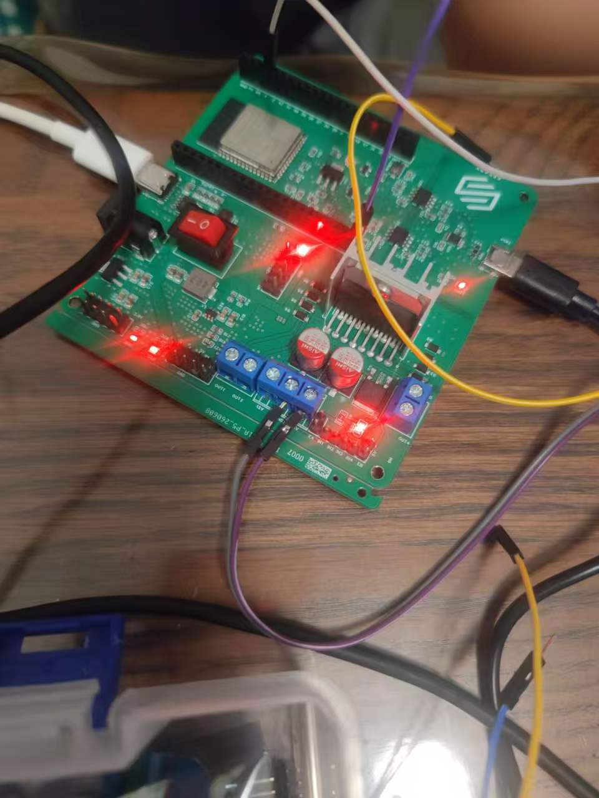
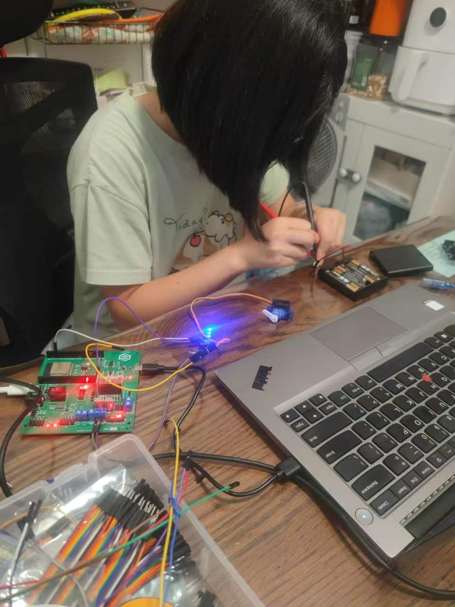

# 🐾 ESP32智能桌面宠物项目 (Deskpet-ESP32)

我是一名高中生，此前参与的项目多为线下实物开发与课内实践。这是我首次将硬件项目托管至 GitHub，记录我的技术成长轨迹。

## 👨‍💻 关于我（过往科创经历）
- **2026**：以清华附中学生身份参与清华大学电子系暑期课程，学习 ESP32-S3 开发，并完成本桌宠项目。
- **2023**：项目《基于手机蓝牙遥控的电控透光“液晶玻璃门”》获**北京市中小学生电子与信息创意实践活动一等奖**（负责创意构思、插接焊接、组装与答辩）。
- **2024**：项目《安全标识口罩设计》获**第24届海淀区中小学生金鹏科技论坛三等奖**。

## ✨ 本项目简介：智能桌宠
这是一个基于 ESP32-S3 开发的桌面陪伴机器人。

**主要功能：**
- **动作系统**：通过 PWM 控制双舵机，实现“玩耍”、“闲逛”等物理动作。
- **交互系统**：光敏传感器检测环境光、旋转编码器连续旋转喂食、按键中断摸头。
- **状态反馈**：I2C OLED 实时显示心情值、饱食状态。

## 📷 实物展示

*(注：完整 Arduino 代码见本仓库 `final.ino` 文件。)*
